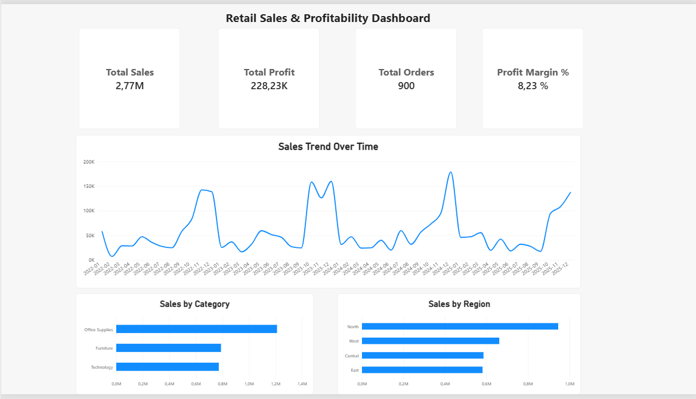
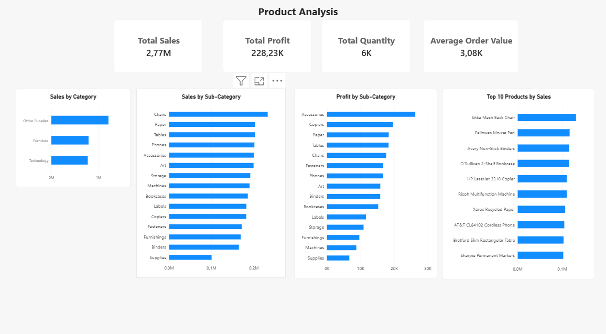
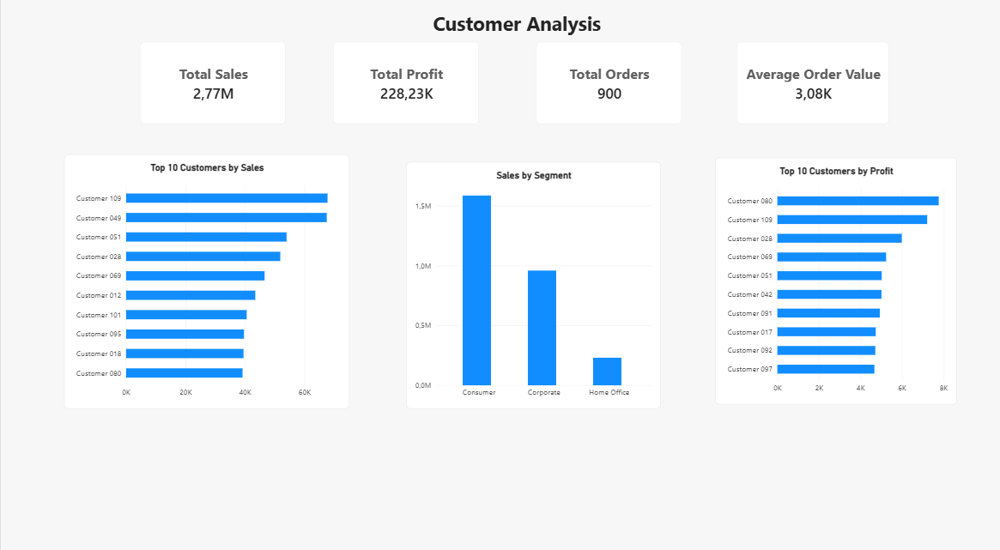
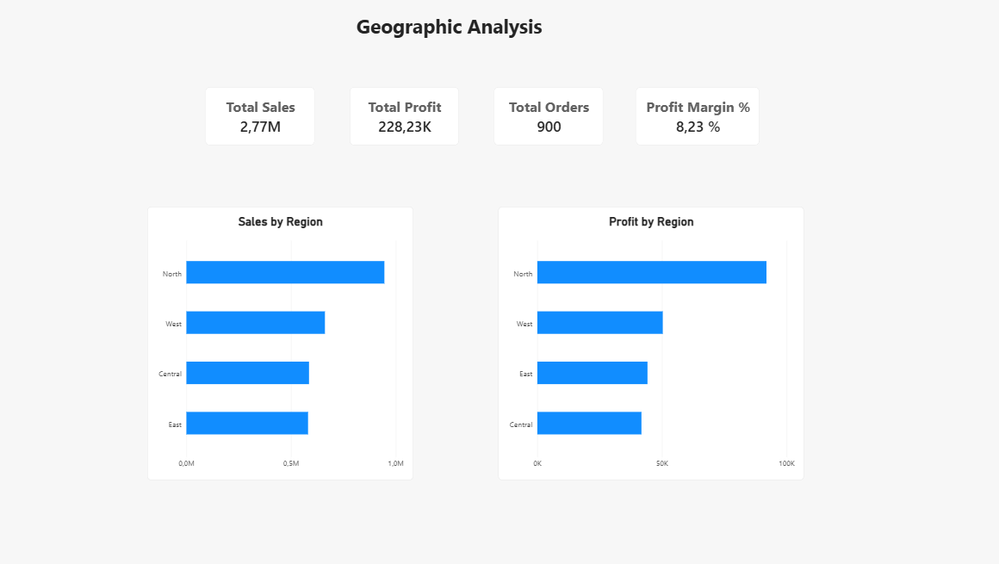
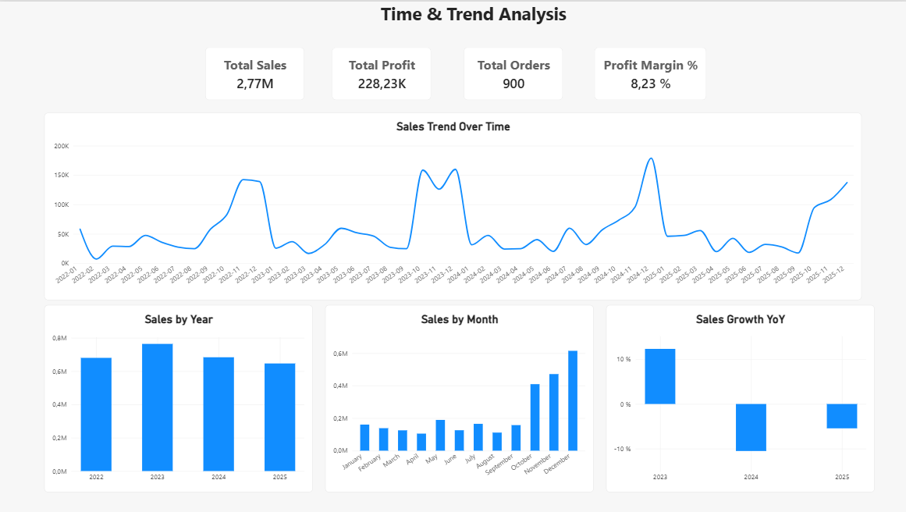

# Retail Sales & Profitability Dashboard — Power BI

## 📊 Présentation du projet

**Retail Sales & Profitability Dashboard** est un projet de Business Intelligence réalisé avec **Microsoft Power BI** à partir du dataset `superstore.csv`.

L'objectif est de transformer des données transactionnelles de ventes en un **tableau de bord interactif** permettant d'analyser :

- les ventes ;
- les bénéfices ;
- les commandes ;
- les produits et sous-catégories ;
- les clients ;
- les segments de clientèle ;
- les performances géographiques ;
- les tendances temporelles ;
- la croissance des ventes d'une année à l'autre.

Le projet met en œuvre une démarche complète de BI : **préparation des données avec Power Query, modélisation en étoile, création de mesures DAX et conception de dashboards interactifs**.

---

## 🎯 Objectifs

Ce projet répond notamment aux questions suivantes :

### Performance globale
- Quel est le chiffre d'affaires total ?
- Quel est le bénéfice total ?
- Combien de commandes ont été réalisées ?
- Quelle est la marge bénéficiaire ?

### Analyse produit
- Quelles catégories génèrent le plus de ventes ?
- Quelles sous-catégories génèrent le plus de ventes ?
- Quelles sous-catégories sont les plus rentables ?
- Quels sont les 10 produits ayant les ventes les plus élevées ?

### Analyse client
- Quels sont les 10 meilleurs clients en chiffre d'affaires ?
- Quels sont les 10 meilleurs clients en bénéfice ?
- Quel segment de clientèle génère le plus de ventes ?

### Analyse géographique
- Quelle région génère le plus de ventes ?
- Quelle région génère le plus de bénéfice ?
- Existe-t-il des différences entre performance commerciale et rentabilité selon les régions ?

### Analyse temporelle
- Comment les ventes évoluent-elles dans le temps ?
- Quelle année génère le plus de ventes ?
- Quels mois sont les plus performants ?
- Quelle est la croissance des ventes par rapport à l'année précédente ?

---

## 🛠️ Technologies utilisées

- **Power BI Desktop**
- **Power Query**
- **DAX**
- **Data Modeling**
- **Star Schema**
- **CSV**
- **Git / GitHub**

---

## 📁 Dataset

Le projet utilise le fichier :

```text
superstore.csv
```

### Caractéristiques du dataset

- **1 530 lignes**
- **21 colonnes**
- Données de transactions commerciales
- Informations sur les commandes
- Informations clients
- Informations produits
- Informations géographiques
- Informations d'expédition
- Données de ventes, quantité, remise et bénéfice

### Principales colonnes

```text
Row ID
Order ID
Order Date
Ship Date
Ship Mode
Customer ID
Customer Name
Segment
Country
City
State
Postal Code
Region
Product ID
Category
Sub-Category
Product Name
Sales
Quantity
Discount
Profit
```

---

# 🔄 Préparation des données

La préparation des données a été réalisée dans **Power Query**.

### Étapes principales

1. Importation de `superstore.csv`
2. Renommage de la table principale en `FactSales`
3. Vérification et correction des types de données
4. Gestion de la localisation pour les valeurs décimales
5. Nettoyage des champs texte
6. Suppression des espaces inutiles
7. Nettoyage des caractères non imprimables
8. Création des tables de dimensions
9. Suppression des doublons dans les dimensions
10. Création de la table calendrier `DimDate`
11. Vérification de la qualité des données
12. Chargement du modèle dans Power BI

---

# ⭐ Modèle de données — Schéma en étoile

Le modèle utilise une architecture **Star Schema**.

La table centrale est :

```text
FactSales
```

Elle est reliée aux tables de dimensions :

```text
DimProduct
DimCustomer
DimDate
```

### Structure

```text
                 DimProduct
                     │
                     │ 1 → *
                     │
                     ▼
DimDate  ───────► FactSales ◄─────── DimCustomer
  1 → *              ▲                 1 → *
                     │
                     │
                 Transactions
```

### FactSales

La table de faits contient notamment :

- Order ID
- Order Date
- Customer ID
- Product ID
- Sales
- Quantity
- Discount
- Profit
- informations de commande et d'expédition

### DimProduct

La dimension produit contient :

- Product ID
- Product Name
- Category
- Sub-Category

Validation :

- 29 Product IDs
- 29 Product Names uniques
- 3 catégories
- 15 sous-catégories

### DimCustomer

La dimension client contient :

- Customer ID
- Customer Name
- Segment
- Country
- City
- State
- Postal Code
- Region

Validation :

- 120 Customer IDs
- 120 Customer Names uniques
- 3 segments
- 1 pays
- 20 villes
- 16 États
- 4 régions

### DimDate

La table calendrier contient :

- Date
- Year
- Quarter
- Month Number
- Month Name
- Year-Month

Validation :

- 1 454 dates
- dates uniques
- années 2022 à 2025
- 4 trimestres
- 12 mois
- 48 périodes Year-Month

### Relations

```text
DimProduct[Product ID]
        1
        │
        │
        *
FactSales[Product ID]
```

```text
DimCustomer[Customer ID]
        1
        │
        │
        *
FactSales[Customer ID]
```

```text
DimDate[Date]
        1
        │
        │
        *
FactSales[Order Date]
```

Les relations sont **actives**, de type **1 → *** avec un filtrage à sens unique.

---

# 🧮 Mesures DAX

Les principales mesures DAX utilisées dans le dashboard sont les suivantes.

## 1. Total Sales

```DAX
Total Sales =
SUM(FactSales[Sales])
```

Calcule le chiffre d'affaires total.

## 2. Total Profit

```DAX
Total Profit =
SUM(FactSales[Profit])
```

Calcule le bénéfice total.

## 3. Total Quantity

```DAX
Total Quantity =
SUM(FactSales[Quantity])
```

Calcule la quantité totale vendue.

## 4. Total Orders

```DAX
Total Orders =
DISTINCTCOUNT(FactSales[Order ID])
```

Compte le nombre de commandes distinctes.

## 5. Average Order Value

```DAX
Average Order Value =
DIVIDE(
    [Total Sales],
    [Total Orders]
)
```

Calcule la valeur moyenne d'une commande.

## 6. Profit Margin %

```DAX
Profit Margin % =
DIVIDE(
    [Total Profit],
    [Total Sales]
)
```

Calcule la marge bénéficiaire.

## 7. Average Quantity per Order

```DAX
Average Quantity per Order =
DIVIDE(
    [Total Quantity],
    [Total Orders]
)
```

Calcule la quantité moyenne par commande.

## 8. Sales YTD

```DAX
Sales YTD =
TOTALYTD(
    [Total Sales],
    DimDate[Date]
)
```

Calcule les ventes cumulées depuis le début de l'année.

## 9. Sales Previous Year

```DAX
Sales Previous Year =
CALCULATE(
    [Total Sales],
    SAMEPERIODLASTYEAR(DimDate[Date])
)
```

Retourne les ventes de la période équivalente de l'année précédente.

## 10. Sales YoY %

```DAX
Sales YoY % =
DIVIDE(
    [Total Sales] - [Sales Previous Year],
    [Sales Previous Year]
)
```

Calcule la croissance des ventes par rapport à l'année précédente.

Les mesures complètes sont également disponibles dans :

```text
documentation/dax_measures.md
```

---

# 📊 Pages du dashboard

Le rapport contient **5 pages d'analyse**.

## 1. Executive Overview

La page principale fournit une vue synthétique de la performance commerciale.

### KPI

- Total Sales
- Total Profit
- Total Orders
- Profit Margin %

### Visualisations

- Sales Trend Over Time
- Sales by Category
- Sales by Region

Cette page permet d'obtenir rapidement une vision globale de l'activité.

---

## 2. Product Analysis

Cette page est consacrée à l'analyse des produits.

### KPI

- Total Sales
- Total Profit
- Total Quantity
- Average Order Value

### Visualisations

- Sales by Category
- Sales by Sub-Category
- Profit by Sub-Category
- Top 10 Products by Sales

Elle permet d'identifier les catégories et produits les plus performants ainsi que les sous-catégories générant le plus de bénéfice.

---

## 3. Customer Analysis

Cette page analyse les performances commerciales par client.

### KPI

- Total Sales
- Total Profit
- Total Orders
- Average Order Value

### Visualisations

- Top 10 Customers by Sales
- Sales by Segment
- Top 10 Customers by Profit

Elle permet notamment d'identifier les clients ayant la plus forte contribution au chiffre d'affaires et au bénéfice.

---

## 4. Geographic Analysis

Cette page présente les performances selon les régions.

### KPI

- Total Sales
- Total Profit
- Total Orders
- Profit Margin %

### Visualisations

- Sales by Region
- Profit by Region

Elle permet de comparer les performances commerciales et la rentabilité entre les différentes régions.

---

## 5. Time & Trend Analysis

Cette page est consacrée à l'évolution temporelle.

### KPI

- Total Sales
- Total Profit
- Total Orders
- Profit Margin %

### Visualisations

- Sales Trend Over Time
- Sales by Year
- Sales by Month
- Sales Growth YoY

Elle permet d'identifier les tendances, les périodes fortes et les évolutions annuelles des ventes.

---

# 🖼️ Captures d'écran

Les principales captures du dashboard sont regroupées dans le dossier :

```text
screenshots/
```

### Executive Overview



### Product Analysis



### Customer Analysis



### Geographic Analysis



### Time & Trend Analysis


---

# 🔍 Qualité des données

Des contrôles de qualité ont été réalisés avant la construction du modèle.

### Résultats

- **1 530 lignes**
- **21 colonnes**
- aucune valeur manquante identifiée
- aucun doublon de ligne identifié
- types de données vérifiés
- champs texte nettoyés
- dimensions contrôlées
- relations du modèle vérifiées

### Types principaux

| Colonne | Type |
|---|---|
| Order Date | Date |
| Ship Date | Date |
| Sales | Decimal Number |
| Profit | Decimal Number |
| Discount | Decimal Number |
| Quantity | Whole Number |
| Postal Code | Text |
| IDs | Text |

La documentation détaillée est disponible ici :

```text
documentation/data_quality.md
```

---

# 📂 Structure du projet

```text
retail-powerbi-dashboard/
│
├── data/
│   └── raw/
│       └── superstore.csv
│
├── powerbi/
│   └── retail_sales_dashboard.pbix
│
├── screenshots/
│   ├── dashboard_overview.png
│   ├── product_analysis.png
│   ├── customer_analysis.png
│   ├── geographic_analysis.png
│   └── time_analysis.png
│
├── documentation/
│   ├── data_model.png
│   ├── dax_measures.md
│   └── data_quality.md
│
├── .gitignore
├── README.md
└── LICENSE
```

> Le fichier `.pbix` peut être conservé dans le dossier `powerbi/`. Selon la taille du fichier et les choix de gestion du dépôt, il peut également être conservé localement plutôt que versionné sur GitHub.

---

# ▶️ Utilisation du projet

## Prérequis

Installer :

- **Power BI Desktop**
- éventuellement **Git** pour cloner le dépôt

## Étape 1 — Télécharger le projet

```bash
git clone https://github.com/JihadKeraoui/retail-powerbi-dashboard.git
```

Puis :

```bash
cd retail-powerbi-dashboard
```

## Étape 2 — Ouvrir Power BI

Ouvrir :

```text
powerbi/retail_sales_dashboard.pbix
```

avec **Power BI Desktop**.

## Étape 3 — Actualiser les données

Dans Power BI :

```text
Accueil
→ Actualiser
```

Si le chemin du fichier CSV a changé, ouvrir :

```text
Transformer les données
→ Paramètres de source de données
```

et adapter le chemin vers :

```text
data/raw/superstore.csv
```

## Étape 4 — Explorer le dashboard

Naviguer entre les différentes pages :

```text
Executive Overview
Product Analysis
Customer Analysis
Geographic Analysis
Time & Trend Analysis
```

Les graphiques sont interactifs : la sélection d'un élément dans un graphique peut filtrer les autres visualisations de la page.

---

# 📈 Principaux indicateurs du dashboard

Sur l'ensemble du dataset, le dashboard affiche notamment :

| KPI | Valeur |
|---|---:|
| Total Sales | 2,77 M |
| Total Profit | 228,23 K |
| Total Orders | 900 |
| Profit Margin | 8,23 % |
| Total Quantity | 6 K |
| Average Order Value | 3,08 K |

Ces indicateurs peuvent évoluer selon les filtres ou sélections effectués dans Power BI.

---

# 💡 Intérêt Business Intelligence

Ce projet montre comment passer d'un fichier de données transactionnelles à un outil d'aide à la décision.

La démarche permet de :

1. préparer et nettoyer les données ;
2. structurer les données dans un modèle analytique ;
3. créer des indicateurs avec DAX ;
4. analyser les performances commerciales ;
5. identifier les produits et clients importants ;
6. comparer les régions ;
7. analyser les tendances temporelles ;
8. présenter les résultats dans un dashboard interactif.

---

# 🚀 Compétences démontrées

Ce projet met en évidence les compétences suivantes :

### Data Preparation
- Power Query
- nettoyage des données
- gestion des types
- contrôle de qualité

### Data Modeling
- modèle en étoile
- tables de faits et dimensions
- relations 1 → *
- table calendrier

### DAX
- agrégations
- `DIVIDE`
- `DISTINCTCOUNT`
- `CALCULATE`
- `TOTALYTD`
- `SAMEPERIODLASTYEAR`
- analyse YoY

### Data Visualization
- KPI Cards
- graphiques en barres
- graphiques temporels
- Top N
- dashboards interactifs

### Business Analysis
- ventes
- bénéfices
- marge
- produits
- clients
- régions
- tendances temporelles

---

# 🔮 Améliorations possibles

Plusieurs évolutions pourraient être ajoutées dans une version future :

- ajout de slicers globaux ;
- analyse détaillée des remises ;
- analyse du délai d'expédition ;
- analyse de la rentabilité par produit ;
- ajout d'une carte géographique ;
- ajout d'indicateurs supplémentaires ;
- amélioration du thème graphique ;
- publication du rapport dans Power BI Service.

---

# 👤 Auteur

**Jihad Keraoui**

Projet réalisé dans le cadre de la constitution d'un portfolio professionnel orienté :

- Data Analysis
- Business Intelligence
- SQL
- Python
- Power BI

---

# 📄 Licence

Ce projet est destiné à un usage de démonstration dans le cadre d'un portfolio professionnel.
